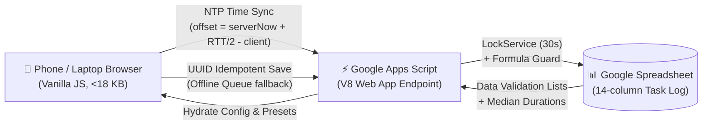

<div align="center">

# ⚡ Daily Task Logger

**A high-velocity, mobile-first Google Apps Script web application built for Network Engineers to log daily operations in seconds with zero clock drift.**

[-4285F4?logo=google-sheets&logoColor=white)](https://developers.google.com/apps-script)
[](client/index.html)
[-success?logo=webpack&logoColor=white)](#performance--footprint)
[](tests/unitTests.js)
[](LICENSE)
[-blueviolet)](#architecture--fixed-stack)

[Overview](#-overview) • [Repository Details](#-repository-details) • [Docker Deployment](#-docker-deployment-self-hosted) • [Configuring Your Spreadsheet](#-configuring-your-spreadsheet-link) • [Key Features](#-key-features) • [Sheet Contract](#-sheet-contract) • [Local Preview](#-local-development--preview) • [Deployment with Clasp](#-deployment-guide-with-clasp) • [Rollback Runbook](#-rollback-runbook)

---

</div>

## 📌 Overview

**Daily Task Logger** replaces tedious spreadsheet entry with a modern, ergonomic web application designed laptop & desktop first with a multi-column dashboard and live activity feed, while retaining a fluid, touch-optimized mobile experience for smartphones.

Every save dynamically resolves headers, clones existing formatting, verifies idempotency, and appends a valid row directly into your Google Sheet without ever risking formula corruption or text-formatted dates.



---

## 📦 Repository Details

| Specification | Detail |
| :--- | :--- |
| **Project Name** | **WireLog** |
| **Repository URL** | [`https://github.com/Zahrexxs/WireLog`](https://github.com/Zahrexxs/WireLog) |
| **Owner / Maintainer** | **[@Zahrexxs](https://github.com/Zahrexxs)** |
| **Default Branch** | `main` |
| **Repository Visibility** | `Private` |
| **Runtime & Engines** | Google Apps Script (V8 Engine) • Node.js (v18+) for testing |
| **Frontend Framework** | Plain Vanilla HTML5, Modern CSS3, ES6 Modules (Zero dependencies) |
| **Production Bundle** | **17.68 KB** gzipped standalone bundle (`client/index.html`) |
| **Test Coverage** | 21/21 Unit Tests passing (`node tests/unitTests.js`) |
| **License** | [MIT License](LICENSE) |

### 🚀 Quick Clone Commands

Choose your preferred git protocol:

```bash
# Via HTTPS
git clone https://github.com/Zahrexxs/WireLog.git

# Via SSH
git clone git@github.com:Zahrexxs/WireLog.git

# Via GitHub CLI
gh repo clone Zahrexxs/WireLog
```

Navigate into the directory and launch the local test server in one command:
```bash
cd WireLog && npm run serve
```

---

## 🐳 Docker Deployment (Self-Hosted)

Run Daily Task Logger on your own local server, Raspberry Pi, home lab, or VPS using Docker in under 30 seconds:

### Quick Run with Docker Compose
```bash
# 1. Clone the repository
git clone https://github.com/Zahrexxs/daily-task-logger.git
cd daily-task-logger

# 2. (Optional) Configure environment
cp .env.example .env

# 3. Start the container in background
docker compose up -d
# Or: docker-compose up -d
```
Open **`http://localhost:3000`** (or your server's local IP address like `http://192.168.1.100:3000`) in any phone or laptop browser!

### Run with Docker CLI
```bash
# Build the image
docker build -t daily-task-logger .

# Run with persistent data volume
docker run -d \
  --name daily-task-logger \
  -p 3000:3000 \
  -v $(pwd)/data:/app/data \
  --restart unless-stopped \
  daily-task-logger
```

---

## 🔗 Configuring Your Spreadsheet Link

You can easily customize which Google Spreadsheet receives your task logs—either per-user directly through the web UI or globally via environment variables:

### Method 1: In the Web App Settings UI (Easiest)
1. Open the web app in your browser (`http://localhost:3000`).
2. Click the **Gear Icon (Settings)** in the top right.
3. In **Google Sheet Web App URL**, paste your Apps Script Web App link:
   `https://script.google.com/macros/s/AKfycb.../exec`
4. Click **Test Connection** to immediately verify communication with your sheet!
5. Click **Save Preferences**. All new tasks saved from your device will now stream directly to your Google Sheet!

*(Note: If you leave this field blank, the server operates in **Local Storage Mode**, safely storing tasks on your server in `./data/tasks.json`.)*

### Method 2: Global Configuration via `.env`
In your `.env` file or `docker-compose.yml`:
```env
# URL of your Google Apps Script Web App
SPREADSHEET_WEBAPP_URL=https://script.google.com/macros/s/AKfycb.../exec

# Preferred port (default 3000)
PORT=3000

# Timezone (default Asia/Jakarta)
DEFAULT_TIMEZONE=Asia/Jakarta
```

---

## ✨ Key Features

<table>
  <tr>
    <td width="50%">
      <h3>🖥️ Desktop-First & 📱 Mobile Fluid</h3>
      <ul>
        <li><b>2-Column Desktop Dashboard</b>: Side-by-side Task/Action and Hostname/Category fields with all metadata visible without accordion clicks.</li>
        <li><b>Live Activity Feed & Stats</b>: Real-time sticky sidebar displays today's tasks logged and total logged minutes.</li>
        <li><b>Ctrl+Enter Fast Save</b>: Instant keyboard commit from any field.</li>
        <li><b>Accessible Mobile Fallback</b>: Responsive layout stacks cleanly on screens &lt;900px with 44px tap targets and thumb-zone ergonomics.</li>
        <li><b>Sticky Defaults</b>: Keeps repeated metadata while resetting Hostname and Remark for the next entry.</li>
      </ul>
    </td>
    <td width="50%">
      <h3>🛰️ Server-Synced Time Engine</h3>
      <ul>
        <li><b>Server Clock of Record</b>: Uses server time (<code>Asia/Jakarta</code> WIB) via round-trip NTP latency offset calculation ($\text{offset} = \text{serverNow} + \frac{\text{RTT}}{2} - \text{receiveTime}$).</li>
        <li><b>Typical Duration Heuristic</b>: Start time automatically calculates as <code>End - typical duration</code> using the historical median of your last 10 entries for that specific Task + Action pair.</li>
        <li><b>Quick Duration Chips</b>: 1-tap buttons (<code>+1m</code>, <code>+5m</code>, <code>+10m</code>, <code>+15m</code>, <code>+30m</code>, <code>+60m</code>, <code>+90m</code>).</li>
      </ul>
    </td>
  </tr>
  <tr>
    <td width="50%">
      <h3>🛡️ Resilience & Offline Protection</h3>
      <ul>
        <li><b>Offline Queue</b>: If your network drops, entries queue locally in <code>localStorage</code> under <code>Pending (n)</code> and auto-flush without duplicates when reconnected.</li>
        <li><b>30-Second Undo Window</b>: Floating toast notification allows rolling back the last write if you made a typo, verifying the row hasn't been edited in the sheet.</li>
        <li><b>Formula Guard (CWE-1236)</b>: Any user text starting with <code>=</code>, <code>+</code>, <code>-</code>, or <code>@</code> is escaped with <code>'</code> so it can never trigger formula injection.</li>
      </ul>
    </td>
    <td width="50%">
      <h3>🔍 Smart Inventory Autocomplete</h3>
      <ul>
        <li><b>Fuzzy Hostname Search</b>: Typing <code>"tomang"</code> matches <code>SW1_KCP JAKARTA TOMANG</code> from the <code>Devices</code> inventory tab and historical entries.</li>
        <li><b>Keyboard Navigable</b>: Full <code>ArrowDown</code>, <code>ArrowUp</code>, and <code>Enter</code> selection.</li>
        <li><b>Uncatalogued Notice</b>: Displays a <code>New device</code> badge for uncatalogued hardware while allowing submission.</li>
        <li><b>CSV Device Importer</b>: Built-in settings utility to upload or paste hardware lists and deduplicate by uppercase hostname.</li>
      </ul>
    </td>
  </tr>
</table>

---

## 📊 Sheet Contract

The backend dynamically locates columns by matching header text (never hardcoded column letters), tolerating inserted columns and the merged **Time Duration** header.

| # | Column Header | Form Control | Format Written | Validation Source | Default |
| :-: | :--- | :--- | :--- | :--- | :--- |
| **1** | `No` | Automatic | Sequential integer (`prev No + 1`) | Leaves formulas untouched | Auto |
| **2** | `Tanggal` | Date picker | Real serial number (e.g. `46266`) | Copied from row above | Today (Auto) |
| **3** | `Task` | Combobox / Text | String (escaped) | Presets & past entries | Last used |
| **4** | `Action` | Combobox / Text | String (escaped) | Presets & past entries | Last used |
| **5** | `Category [CR, INCIDENT, SUPPORT]` | 3-way toggle | String | Sheet data validation | `SUPPORT` |
| **6** | `Project Category` | Dropdown | String | Sheet data validation | `KANTOR CABANG` |
| **7** | `Severity` | Dropdown | String | Sheet data validation | `Minor` |
| **8** | `Impacted Device [Hostname]` | Autocomplete | Uppercase string | `Devices` tab + Sheet rows | Blank |
| **9** | `Status` | Dropdown | String | Sheet data validation | `CLOSED` |
| **10** | `Request by` | Dropdown | String | Sheet data validation | `Desktop` |
| **11** | `Time Duration: Start` | Time input | Day fraction (e.g. `551/1440`) | Number format cloned | Auto (`End - duration`) |
| **12** | `Time Duration: End` | Time input | Day fraction (e.g. `551/1440`) | Number format cloned | Auto (`now`) |
| **13** | `Engineer` | Dropdown | String | Sheet data validation / Settings | Stored PIC Name |
| **14** | `Remark/Note` | Textarea | String (escaped) | Free text | Blank |

---

## 📁 Repository Structure

```
daily-task-logger/
├── .clasp.json              # Clasp project configuration
├── .claspignore            # Excludes dev files from Apps Script push
├── appsscript.json          # Apps Script V8 runtime manifest (Asia/Jakarta)
├── package.json             # Test and dev scripts
├── README.md                # Project documentation
│
├── client/                  # Frontend Web App (<18 KB gzipped)
│   ├── index.html           # Standalone single-page responsive UI
│   ├── styles.css           # Clean CSS with auto dark mode (<14 KB)
│   ├── app.js               # State machine, offline queue, timer, sticky defaults
│   ├── clockSync.js         # NTP round-trip client-server clock synchronizer
│   └── autocomplete.js      # Client-side fuzzy search for device hostnames
│
├── server/                  # Google Apps Script Backend (V8)
│   ├── Code.js              # Web app endpoints (doGet, saveEntry, getConfig, undoLast)
│   ├── columnMapper.js      # Resilient header matcher & merged header resolver
│   ├── sheetOperations.js   # Safe next-row finder & style/validation cloner
│   ├── timeUtils.js         # Google Sheets serial date and day fraction converter
│   └── validation.js        # UUID idempotency guard & formula injection escaper
│
├── tests/                   # Automated Verification Suite
│   ├── mockSpreadsheetApp.js# Mock Google Apps Script environment for Node.js
│   ├── unitTests.js         # 21-scenario unit test runner
│   ├── localServer.js       # Local dev server with mock google.script.run
│   └── e2eChecklist.md      # 20-point verification checklist
│
├── scripts/
│   └── build.js             # Compiles standalone client/index.html for deployment
└── docs/
    ├── PRD.md               # Authoritative Product Requirements Document
    └── SPRINTS.md           # Completed sprint backlog (S1–S4)
```

---

## 🧪 Local Development & Preview

You can preview the app and run all unit tests locally without deploying to Google:

### 1. Run Unit Tests (21 Test Scenarios)
```bash
npm test
# Or: node tests/unitTests.js
```
*Validates serial date conversions, day fractions, merged header column mapping, formula escaping, NTP clock maths, and fuzzy search.*

### 2. Start Local Development Server
```bash
npm run serve
```
Open **[http://localhost:3000](http://localhost:3000)** in your browser. 
The local server simulates `google.script.run` in-memory with a mock spreadsheet, allowing full end-to-end testing of presets, duration chips, timer mode, and autocomplete.

---

## 🚀 Deployment Guide with Clasp

<details>
<summary><b>Click to expand step-by-step Google Apps Script deployment instructions</b></summary>
<br>

### Step 1: Install Clasp and Authenticate
Ensure you have Node.js installed, then run:
```bash
npm install -g @google/clasp
clasp login
```
*(Make sure the Google Apps Script API is enabled on your Google account at https://script.google.com/home/usersettings)*

### Step 2: Link to Your Google Sheet
1. Open your Google Spreadsheet (e.g., `"Task Log TEST"`).
2. Click **Extensions** > **Apps Script**.
3. In the script editor, click the **Gear Icon (Project Settings)** and copy your **Script ID**.
4. Open [`.clasp.json`](.clasp.json) and paste your Script ID:
   ```json
   {
     "scriptId": "YOUR_COPIED_SCRIPT_ID_HERE",
     "rootDir": "."
   }
   ```

### Step 3: Build and Push Code
```bash
npm run build
clasp push
```

### Step 4: Configure Script Properties
In the Apps Script editor (**Project Settings** > **Script Properties**):
* `TASK_LOG_SHEET_NAME`: Name of your sheet tab (e.g. `Task Log`).
* `HEADER_ROW`: Header row index (default: `1`).
* `DEFAULT_TIMEZONE`: Default timezone (default: `Asia/Jakarta`).

### Step 5: Deploy the Web App
1. In the Apps Script editor, click **Deploy** > **New deployment**.
2. Select type: **Web app**.
3. Settings:
   * **Description**: `Daily Task Logger v1.0`
   * **Execute as**: `Me` (your Google account)
   * **Who has access**: `Only myself`
4. Click **Deploy** and copy the generated Web App URL.
5. Open the URL on your mobile browser, tap **Share** > **Add to Home Screen** to install it as an app icon!

</details>

---

## 🔄 Rollback Runbook

<details>
<summary><b>Click to expand disaster recovery and rollback runbook</b></summary>
<br>

### Production Cut-Over
1. Verify all 20 test cases in [`tests/e2eChecklist.md`](tests/e2eChecklist.md) pass on your test sheet copy.
2. In **Project Settings** > **Script Properties**, update `TARGET_SHEET_ID` to your production spreadsheet ID (or bind the script directly to the production spreadsheet).
3. Save one live test entry and confirm:
   * Incremental `No` matches previous rows.
   * Dates and times land as true numeric values matching adjacent cell formatting.
   * Dropdown options strictly match sheet data validation rules.

### Instant Rollback
* **Web App Rollback**: In the Apps Script editor, navigate to **Deploy** > **Manage deployments** > **Edit (Pencil icon)** > select the previous version under **Version** > click **Deploy**. Rollback is effective immediately across all devices.
* **Row Restoration**: Google Sheets native **Version History** (`Ctrl + Alt + Shift + H`) preserves every write and can restore any row in one click.

</details>

---

<div align="center">

Built with ⚡ for Network Engineers by **[@Zahrexxs](https://github.com/Zahrexxs)**

</div>
